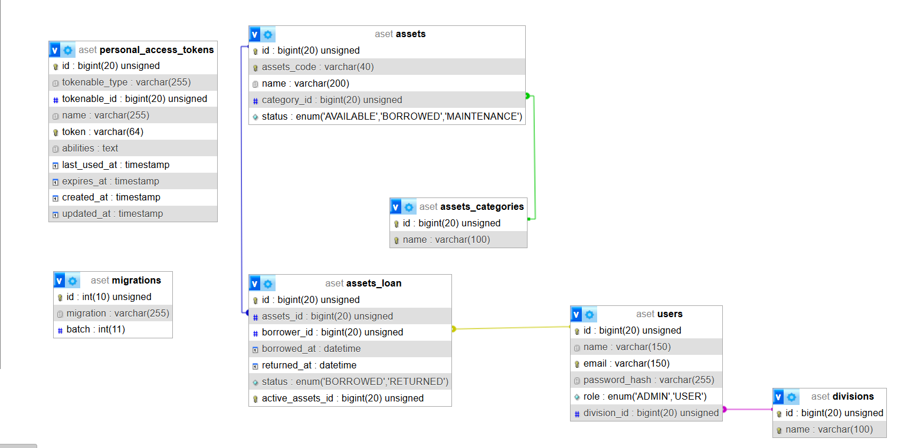
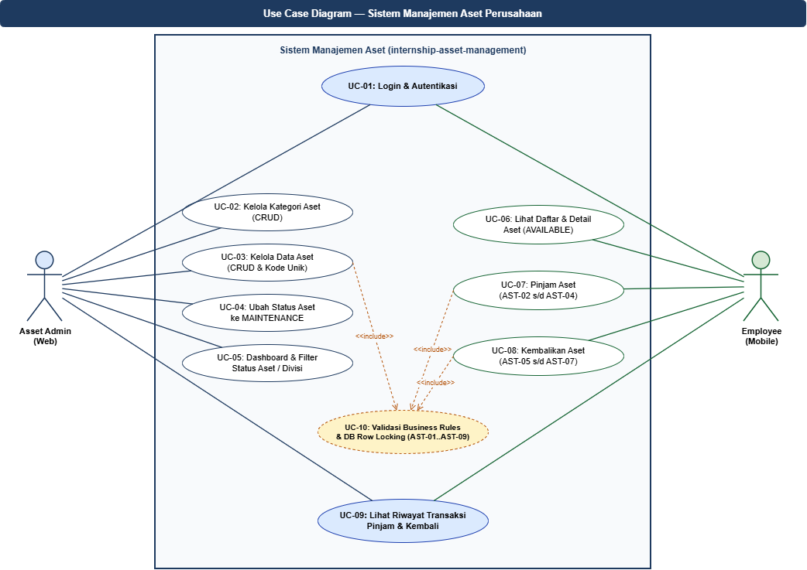
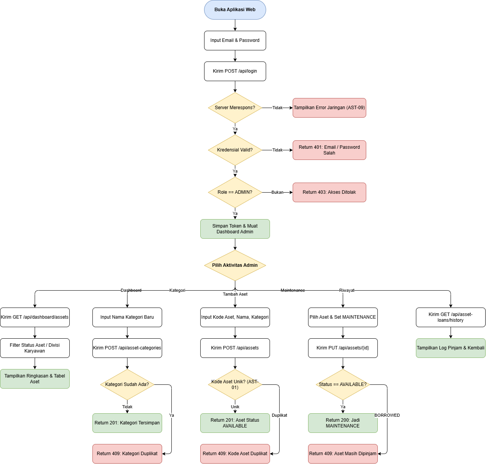
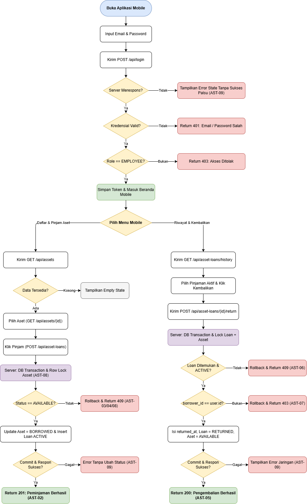
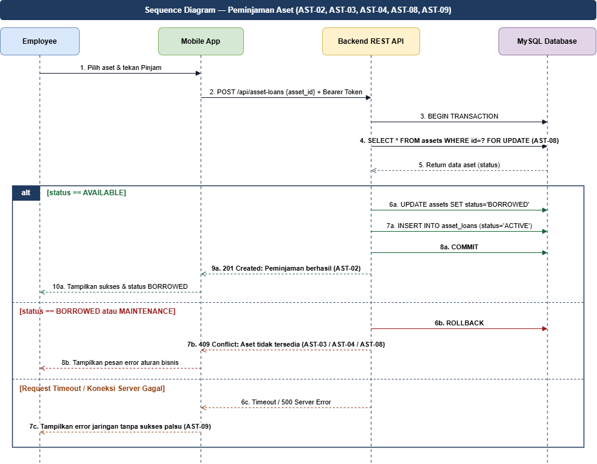
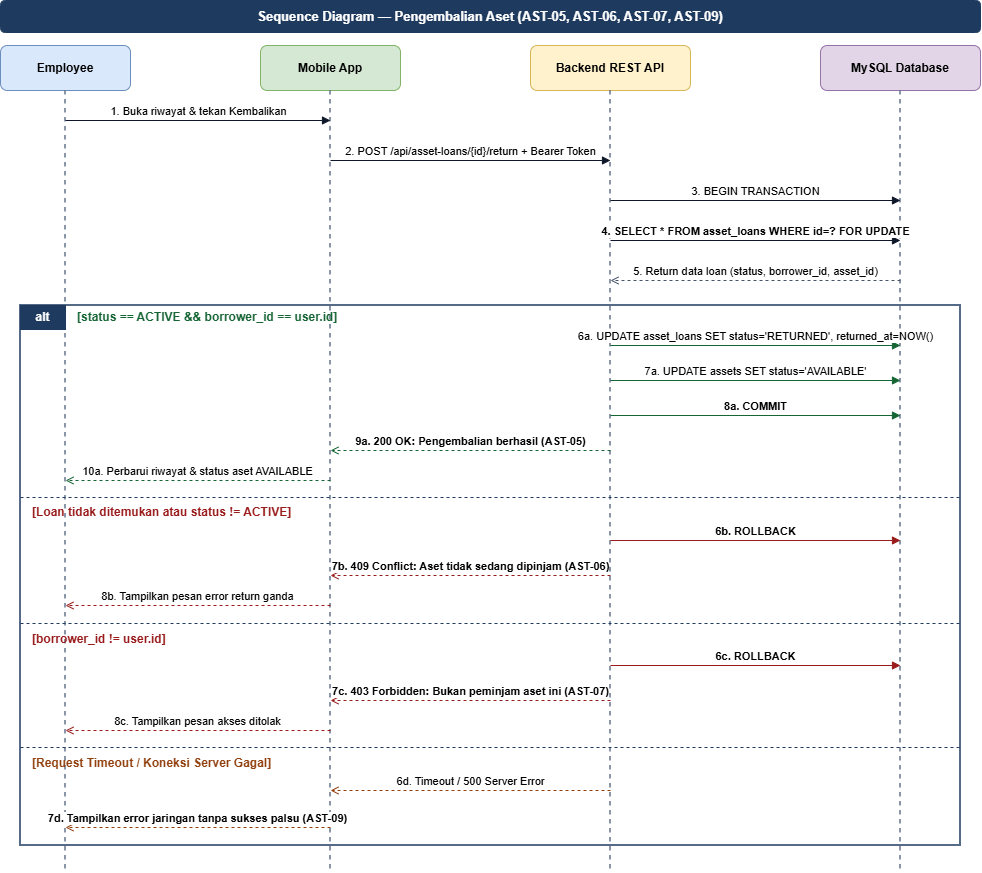

# System Design Diagrams — Manajemen Aset (Tim B)

## 1. Entity Relationship Diagram (ERD)

## 2. Use Case Diagram

## 3. Flowchart Web Admin

## 4. Flowchart Mobile Employee

## 5. Sequence Diagram — Peminjaman Aset

## 6. Sequence Diagram — Pengembalian Aset
